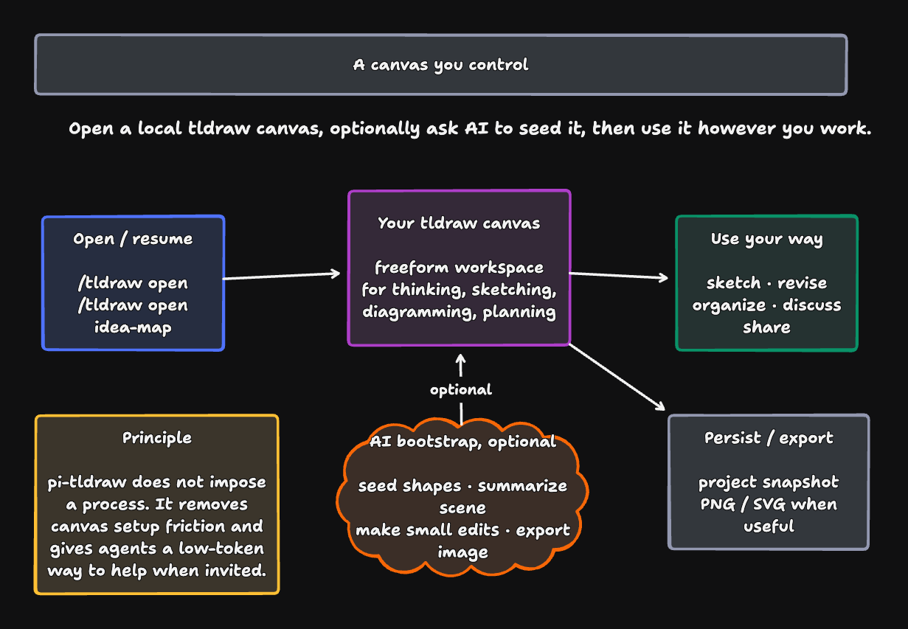

# pi-tldraw

[](https://www.npmjs.com/package/pi-tldraw)
[](https://github.com/zeebeeCoder/pi-tldraw/actions/workflows/ci.yml)
[](https://github.com/zeebeeCoder/pi-tldraw/actions/workflows/publish.yml)
[](https://www.npmjs.com/package/pi-tldraw)
[](./LICENSE)
[](https://github.com/zeebeeCoder/pi-tldraw)
[](#development-and-release)

**Draw with agents without the canvas cold start.**

pi-tldraw packages the tldraw MCP app as a Pi extension so agents can open, inspect, edit, persist, resume, and export local tldraw canvases with minimal setup. It focuses on ergonomics for both sides of the loop: end users get a one-command canvas workspace, while agents get lean tools that compress complex drawings into semantic lenses instead of spending tokens on raw shape dumps.

Use it for fast concept sketching, diagram generation, and iterative fine-tuning. The extension keeps the feature set intentionally small: multiple canvases per project folder, durable project snapshots, session resume, semantic canvas summaries, precise exec/edit tools, and PNG/SVG export.

## Install

```bash
pi install npm:pi-tldraw
```

Pinned install:

```bash
pi install npm:pi-tldraw@0.1.0
```

Local checkout:

```bash
pi -e .
```

Runtime: the extension talks to a local tldraw MCP endpoint at `http://127.0.0.1:8787/mcp`; the npm package ships a prebuilt `mcp-app/` and auto-starts it when needed, while advanced users can override with `TLDRAW_MCP_APP_DIR`, `TLDRAW_MCP_URL`, or `TLDRAW_MCP_AUTO_START=false`.

## How it works

pi-tldraw builds on the tldraw MCP app and adds the Pi extension shape around it: a local browser host, typed agent tools, project-scoped snapshot persistence, semantic scene rendering, and export helpers. The key agent affordance is `tldraw_canvas_scene`, which turns canvas state into a compact graph/scene view so the model can quickly understand large diagrams before editing them.

## Canvas workspace



pi-tldraw does not prescribe a diagramming process. It gives you a local tldraw canvas for the current project and lets AI help only when useful: seed a first sketch, summarize what is on the canvas, make a small edit, or export an artifact.

Minimal use:

```text
/tldraw open [canvasId]
```

From there, the canvas is yours: sketch, organize, revise, discuss, or ignore the agent entirely. Project snapshots are persisted automatically, and PNG/SVG export is available when you want to share the result.

## Normal UX

Start or restore the current project canvas:

```text
/tldraw open
```

Then work in the browser canvas. Edits are autosaved into the current project folder:

```text
.pi/tldraw-canvases/index.json
.pi/tldraw-canvases/<canvasId>.json
```

You should not need a manual save during normal use.

## Useful commands

```text
/tldraw open [canvasId]      # Open/restore canvas; creates one if needed
/tldraw new <canvasId>       # Alias for open; memorable when starting a canvas
/tldraw use <canvasId>       # Alias for open; memorable when switching canvases
/tldraw ls                   # Alias for canvases; list saved project canvases
/tldraw list                 # Alias for canvases
/tldraw host                 # Show host/server/autosave diagnostics
/tldraw canvases             # List saved project canvases
/tldraw current              # Show current project canvas id
/tldraw restart              # Restart local MCP app server
/tldraw save                 # Manual checkpoint; refuses unsafe blank overwrite
/tldraw save!                # Force manual empty overwrite
/tldraw reset                # Reset MCP HTTP session
```

Short normal workflow:

```text
/tldraw save
/tldraw new design-v2
/tldraw ls
```

## Agent tools

- `tldraw_canvas_open` — open/restore the local browser canvas host.
- `tldraw_diagram_tips` — get minimalist drawing guidance before creating or revising a diagram.
- `tldraw_canvas_export` — export the current selection or whole canvas as a PNG/SVG image for visual feedback.
- `tldraw_canvas_scene` — compact semantic canvas view; falls back to saved snapshots.
- `tldraw_canvas_state` — inspect live canvas state and optionally save it.
- `tldraw_canvas_exec` — execute JavaScript against the live tldraw editor.
- `tldraw_search` — inspect the tldraw Editor API via the MCP search tool.
- `tldraw_status` — check MCP server tools/resources.

## Persistence model

The durable source of truth is project-local JSON:

```text
<project>/.pi/tldraw-canvases/<canvasId>.json
```

The MCP server checkpoint store is treated as transient runtime state. If the browser port, MCP session, or Wrangler state changes, `/tldraw open` restores from the project snapshot.

Safety rules:

- Autosave and manual save refuse to overwrite a non-empty saved snapshot with an empty live canvas.
- Forced empty overwrite is available with `/tldraw save!`.
- Previous snapshots are copied to `.pi/tldraw-canvases/history/<canvasId>/` before overwrite.

## Development and release

```bash
npm install
npm run build
npm run check
npm run pack:dry
```

Development stays source-owned but release-friendly: the browser bridge is rebuilt from `bridge/app-bridge-entry.js`, while the packaged `mcp-app/` ships prebuilt `dist/` assets so users do not rebuild tldraw during install or startup. Provenance for the packaged MCP app lives in `mcp-app-source.json`, `patches/tldraw-mcp-app/`, and `mcp-app/PI_TLDRAW_PROVENANCE.json`.

Useful maintainer checks:

```bash
npm run verify:mcp-app-source
npm run verify:package
npm run e2e:packaged-mcp-app
```

GitHub Actions verifies build drift, package contents, tests, and provenance before publishing with npm provenance.
